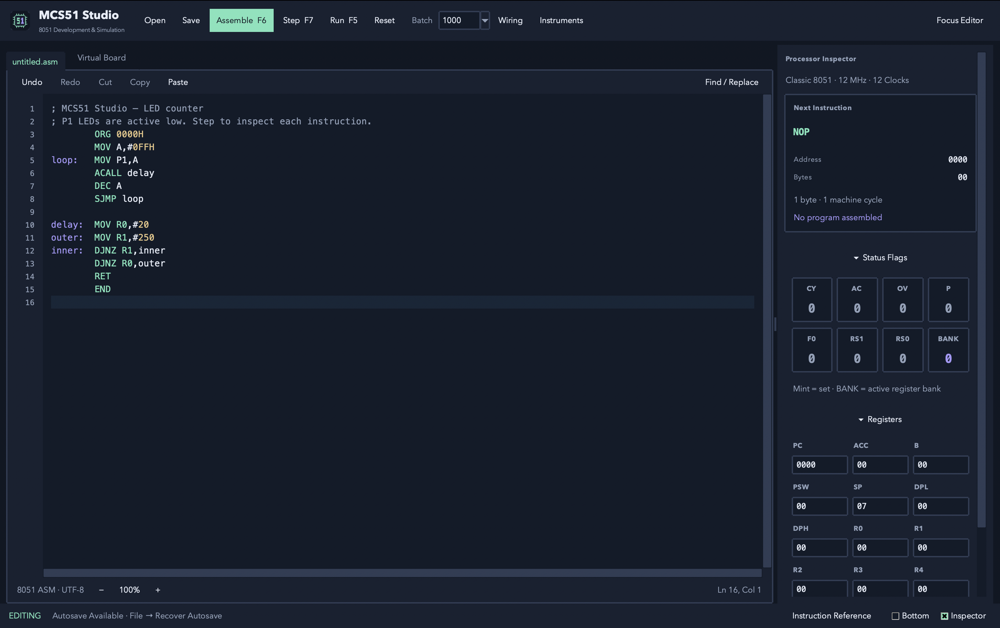

The workbench brings your source, the simulated processor, and connected hardware into one window. Start with the editor and inspector; open other tools as you need them.

## The command row

The top row contains **Open**, **Save**, **Assemble**, **Step**, **Run**, and **Reset**. It also provides the **Batch** control, **Wiring**, **Instruments**, and **Focus Editor**.

Use this short loop while learning:

1. Change the source.
2. **Assemble (F6)** to rebuild the machine code.
3. **Step (F7)** to execute one instruction.
4. Inspect the result before continuing.

**Run (F5)** executes continuously and becomes the pause control while running.

## Editor and Virtual Board

The central workspace has an assembly editor tab and a **Virtual Board** tab. Switch between them to connect an instruction with the hardware result.

The board groups digital I/O, the four-digit display, and peripheral cards. An enabled device may be idle; its badge helps distinguish that from disabled hardware. The LED and display states show the current simulation state.

**Show Transitions** is enabled by default. It briefly yields after LED or display changes so fast loops remain visible. Turn it off for greater throughput; intermediate states may then be skipped on screen. Simulated instruction order and cycle counts stay the same.

## Processor Inspector

The inspector shows **Classic 8051 · 12 MHz · 12 Clocks**, followed by:

- **Next Instruction:** source, address, encoded bytes, and timing for the instruction about to execute.
- **Status Flags:** PSW flags and the active register bank.
- **Registers:** hexadecimal values, with changed values highlighted in mint.
- **Bitfield:** an SFR name or hexadecimal RAM address, with individual bits.

To change an editable register, enter a hexadecimal value and press **Enter**. Hover over a register label to see its address. In Bitfield, only bit-addressable bytes can be toggled.

Manual edits to registers or memory clear tracked call frames. Use [debugger watches](../debugging/#watch-a-value) when you want to observe values without changing the machine.

## Bottom tools

- **Listing** connects assembled addresses and bytes with the corresponding source. Double-click a row to toggle its breakpoint.
- **Memory** inspects RAM, SFRs, Code, and XDATA. Double-click editable bytes to change them while paused.
- **Debug** contains Last Instruction, Watches, Stack, and additional execution controls.
- **Activity** shows assembly results and diagnostics. It opens when assembly fails.

The footer also opens the built-in **Instruction Reference**.

## Arrange the window

Drag horizontal and vertical dividers to resize the panes. Use the status-bar **Inspector** and **Bottom** controls or the View menu to hide them. **Focus Editor** hides supporting panels; choose it again to restore them.

If a panel becomes too small or disappears, choose **View → Reset Layout**. Layout preferences are remembered between sessions.

## Understand Batch

Batch limits execution work per interface update. Choose a preset or type a count from **1 to 1,000,000** and press Enter. Typing without Enter leaves the previous value active. You can change it while running.

Batch is a playback/performance control. It does not change the oscillator frequency. For timing observations, use the simulated costs and [instruments](../../peripherals/instruments/).
